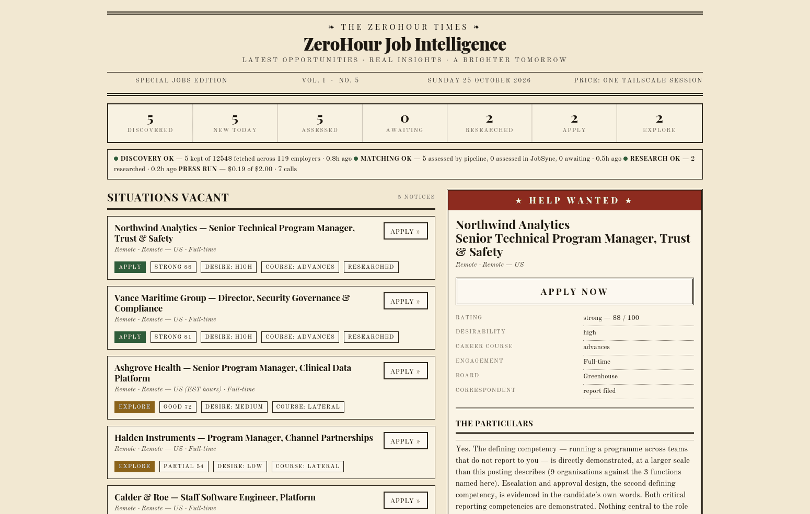

# The ZeroHour Times

**A daily newspaper for your job search.** It watches real employer job boards,
assesses each opening against *your* verified background, researches the most
promising ones on the web, and prints the result as a front page you read with
coffee instead of a dashboard you have to interrogate.

**The ZeroHour Times is an independent intelligence and governance layer built
around [JobSync](https://github.com/Gsync/jobsync)** — an excellent open-source
job tracker by **[Gsync](https://github.com/Gsync)**, MIT licensed, which this
project runs **unmodified from its official image** and talks to only through
the MCP interface JobSync itself publishes.

JobSync is not part of this repository and is not mine. It owns your
applications, statuses and saved assessments; this project finds the jobs,
assesses them against your verified background, researches the best ones, and
prints the result. Full credit and the reasoning behind that boundary are in
[ATTRIBUTION.md](ATTRIBUTION.md) — **please star
[Gsync/jobsync](https://github.com/Gsync/jobsync) too.**

<!-- SCREENSHOT: capture docs/images/newspaper.png from DEMO data (see
     docs/images/README.md), then replace this comment with the line below.

-->

> **See it before you install anything.** Demo mode builds the front page from
> bundled fictional data — no API key, no JobSync account, nothing to configure:
>
> ```bash
> docker compose -f docker-compose.demo.yml up --build
> ```

**Docs:** [Quick start](#quick-start) · [Full tutorial](docs/TUTORIAL.md) ·
[Connecting JobSync](docs/CONNECT-JOBSYNC.md) · [Architecture](docs/ARCHITECTURE.md) ·
[AI governance](docs/AI-GOVERNANCE.md) · [Security & privacy](SECURITY.md) ·
[Testing](docs/TESTING.md) · [Attribution](ATTRIBUTION.md)

---

## What it does

```
  your employer boards ──▶  discover  ──▶  filter  ──▶  JobSync (system of record)
                                                            │
                                      assess ◀──────────────┘
                                         │
                      research the best ──┤
                                         ▼
                              your daily front page
```

1. **Discover** — polls Greenhouse, Lever and Ashby boards for a watchlist of
   employers. Public, keyless, first-party: no scraping, no ghost jobs, no
   recruiter spam.
2. **Filter** — remote/location rules and title include/exclude lists.
3. **Import** — pushes new postings into JobSync through its MCP interface,
   which deduplicates them for you.
4. **Assess** — one AI call per *new* posting produces an evidence-cited
   assessment: can you do this job today, what supports that, what is missing,
   what the daily work looks like, and **apply / explore / skip**.
5. **Research** — the top few get a web-grounded company report with source URLs.
6. **Print** — a static newspaper page, rebuilt after every run.

## Why it is not just "ChatGPT, rank these jobs"

The hard part of an AI job matcher is not generating text. It is **stopping the
model from being agreeable.** A first version of this scored every single role
85–92 "strong", including a partner-channel job whose own analysis admitted the
candidate had never run a partner programme.

What fixed it is the part worth reading:

- **The model must declare its evidence in a structured table** — the 2–4
  competencies that define a role, each marked *Demonstrated*, *Transferable*,
  *Not Documented* or *Confirmed Gap*, with a citation.
- **Code overrides the model's own score.** If the competency the job exists to
  apply is undocumented, the rating is capped — by a validator, not by asking
  the model nicely. The downgrade is printed in the assessment so you can see it.
- **"Not documented" is never "you lack this."** An absence of evidence is
  reported as an absence of evidence. That distinction decides whether a job is
  worth applying for, and most matchers collapse it.
- **Unknown stays unknown.** If a posting gives only an OTE, the base is
  reported as not stated rather than estimated. No invented salaries, no
  invented remote eligibility, no invented credentials.

[docs/AI-GOVERNANCE.md](docs/AI-GOVERNANCE.md) documents how the system is
evaluated, what it got wrong, and what it still gets wrong.

## Quick start

**Requirements:** Docker, and about ten minutes. Linux, macOS (Intel or Apple
Silicon) and Windows all work — on Windows, run these commands inside WSL2 or
Git Bash, because `setup.sh` is a shell script.

```bash
git clone https://github.com/Zerohourcyber/zerohour-times.git
cd zerohour-times
./scripts/setup.sh          # generates secrets, asks a few questions
docker compose up -d
```

Then:

1. Open **JobSync** at <http://localhost:3737> and **create your account
   immediately** — JobSync's signup is open by default, so the first person to
   reach that port gets the account.
2. In JobSync: **Settings → MCP → create token**. Scope it to **`jobs:write`
   only** and set an expiry. Put it in `.env` as `JOBSYNC_MCP_TOKEN`.
3. Edit **`profile.md`** — this is what the AI assesses you against, and it is
   instructed never to claim anything that is not in it.
4. `docker compose restart zerohour-times`
5. Read your newspaper at <http://localhost:8099>

Steps 1–3 happen in a browser and take about five minutes — they are written out
click by click in **[docs/CONNECT-JOBSYNC.md](docs/CONNECT-JOBSYNC.md)**.
The complete beginner walkthrough is **[docs/TUTORIAL.md](docs/TUTORIAL.md)**.

## Demo mode vs live operation

|  | Demo | Live |
|---|---|---|
| Command | `docker compose -f docker-compose.demo.yml up --build` | `docker compose up -d` |
| Needs an API key | No | For assessments and research |
| Needs a JobSync account | No | Yes |
| Data shown | Three **fictional** jobs bundled with the repo | Real openings from your watchlist |
| Costs money | No | A few cents a day |
| Writes anything | No | JobSync records + `/data` |

Demo mode exists so you can judge the thing before spending anything. It reads
`samples/state/`, which contains invented employers and an invented candidate —
no real person's job search is in this repository.

## Configuration

Everything lives in two gitignored files.

| File | What it holds |
|---|---|
| `.env` | Secrets, timezone, run time, ports. From `.env.example`. |
| `config.json` | Employer watchlist, filters, model, budgets. From `config.example.json`. |
| `profile.md` | Your verified background. Built by `python3 scripts/profile.py`. |

Your profile is the single most important file here — every assessment is made
against it, and the model is instructed never to claim anything that is not in
it. You do not have to hand-write it:

```bash
python3 scripts/profile.py        # asks plain questions, writes the structure
python3 scripts/profile.py --show # print what it has
```

`config.example.json` ships with **five example employers** so you can see the
shape and replace them with your own — it is not a recommended list.

A larger optional starting point is in **`starter-watchlist.json`**: 119 boards,
each verified to return postings when it was added, weighted toward technology,
security and GRC because that is what its author was searching for. Copy the
entries you want, or merge the lot. Verify before trusting it — companies change
ATS, and a stale token looks exactly like "no openings".

Add your own employers by name:

```bash
echo "Some Company" >> employers.txt
docker compose exec zerohour-times python3 /app/zhtimes/resolve.py \
    --names /app/employers.txt --merge /app/config.json
```

`resolve.py` probes the real board APIs and **only keeps a token that returns
postings**, because a wrong token fails silently and looks exactly like an
employer with no openings.

## Cost

You bring your own API key. Typical figures, measured:

| | |
|---|---|
| Assessment | ~**$0.02** per posting |
| Company research | ~**$0.05** per company (web search pulls page content into context) |
| Typical day | **well under $1** at 3 researched + a handful of new postings |

A **hard daily cap** is enforced in code, keyed to your local date and shared
between assessment and research. It stops mid-run when reached. Set it in
`config.json` → `matching.max_usd_per_day`. Discovery and the dashboard cost
nothing — the board APIs are free.

## Security

Full detail in **[SECURITY.md](SECURITY.md)**. The short version:

- **The dashboard is read-only and UNAUTHENTICATED.** It binds to `127.0.0.1`
  by default. It shows your assessments and profile-derived analysis — do not
  expose it to a network you do not control.
- **JobSync's signup is open by default and cannot be disabled.** Claim your
  account the moment you first start it. Keep it bound to localhost or a
  private network.
- **Secrets never enter the repo.** `.env`, `profile.md` and `config.json` are
  gitignored; only the `.example` files are versioned.
- **Scope the MCP token to `jobs:write`** and give it an expiry.
- **Web content is treated as untrusted.** Job postings and the pages behind
  them are attacker-controlled. The research stage is a stateless call with
  exactly one tool and no credentials; its output is stored and displayed,
  never executed, never used to choose a tool, and never written back into
  JobSync. A successful prompt injection achieves nothing worse than a
  misleading paragraph in a report a human reads.

## Known limitations

Stated plainly, because you should know them before trusting the output:

- **Read the verdict and the reasoning, not the number.** Calibration against a
  deliberately adversarial set showed the *rejection* logic is reliable
  (12 of 12 correct on engineering roles, junior titles, non-remote roles and
  roles requiring credentials the candidate lacked), while the *ranking* of good
  matches moved by a band or more between prompt versions.
- **Run-to-run variance on identical input has not been measured.**
- Only Greenhouse, Lever and Ashby are supported. Workday, SmartRecruiters and
  Workable are not.
- Scoring needs a profile that describes outcomes, not duties. A vague profile
  produces vague assessments.

## Project layout

```
zhtimes/          discover · match · research · report · resolve · run
prompts/          the versioned assessment prompt
samples/          fictional data so the demo runs with no keys
docs/             tutorial and AI governance notes
```

Pure Python standard library — **no dependencies to install, no lockfile, nothing
to rot.**

## Licence

MIT — see [LICENSE](LICENSE). JobSync is MIT and belongs to its own author; see
[ATTRIBUTION.md](ATTRIBUTION.md).
