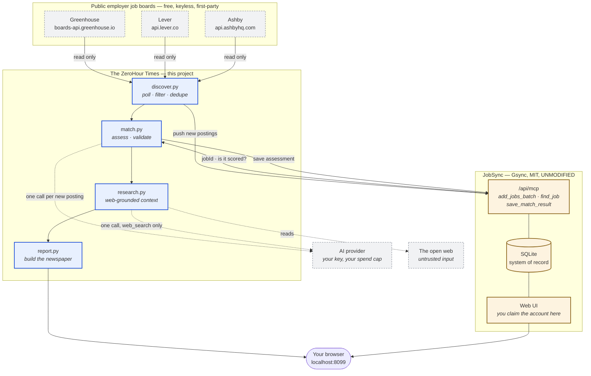

# Architecture

Two containers. One is ours, one is not.



## What belongs to whom

| Component | Owner | Licence |
|---|---|---|
| `zhtimes/*`, prompts, dashboard, docs | **This project** | MIT |
| JobSync (image, UI, database, MCP server) | [Gsync](https://github.com/Gsync/jobsync) | MIT — **unmodified, not forked** |
| Greenhouse / Lever / Ashby board APIs | Those companies | Public endpoints; read-only use |
| The AI model | Your provider | Your key, your account, your spend |

## Why the boundary sits where it does

**JobSync is the system of record.** It owns your applications, statuses and
saved assessments. This project never writes to its database, never reads it,
and never forks it — it talks only through the MCP tools JobSync publishes.
Upgrading JobSync is a tag bump in `docker-compose.yml`.

**The stages are independent.** Discovery costs nothing and needs no AI.
Matching needs an AI key. Research needs an AI key and the web. Each runs in its
own subprocess; one failing does not stop the others, and the newspaper is
rebuilt either way so a failure is visible on the page rather than silently
absent.

**The trust boundary is around the model, not inside it.** Job postings and web
pages are attacker-controlled. The research stage is stateless, has exactly one
tool, and holds no credentials. Its output is stored and displayed — never
executed, never used to pick a tool, never written back into JobSync. Model text
is HTML-escaped before any markup is applied. A successful prompt injection
achieves a misleading paragraph in a report a human reads, and nothing else.

**Code checks the model.** `validate()` reads the structured claims the model
makes about its own evidence and caps the rating when they contradict its score.
See [AI-GOVERNANCE.md](AI-GOVERNANCE.md).

## Data flow in one pass

1. `discover.py` polls each watchlist board, applies your filters, drops local
   duplicates, pushes new postings into JobSync (`add_jobs_batch`, which upserts),
   and writes a queue for the next stage.
2. `match.py` asks JobSync which queued postings exist and whether they already
   carry an assessment (`find_job`), scores only the new ones, runs the validator,
   and saves results (`save_match_results_batch`). Existing assessments are never
   overwritten without an explicit flag.
3. `research.py` picks up to three by verdict and preference — never by score —
   and gathers web-grounded company context, cached so nothing is paid for twice.
4. `report.py` reads only this project's own files and writes `index.html` and
   `report.json` atomically.

## State

No database of our own. One directory, one volume:

```
/data/
  queue.json              today's candidate postings
  assessments.jsonl       append-only: every assessment, with cost and prompt version
  research.jsonl          append-only: every research call
  seen.json               URLs already pushed, so lookups scale with new postings
  externally-scored.json  jobs assessed by hand in JobSync — never touched
  spend.json              daily spend and call count
  www/index.html          the newspaper
```
